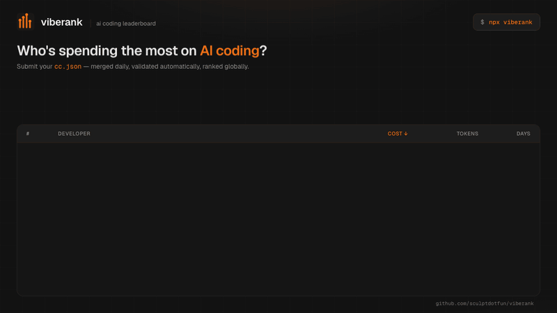

# viberank

**The weekly league for AI coding.** Every Monday 00:00 UTC a new week starts. Your Claude Code, Codex, Gemini CLI and OpenCode usage (anything [`ccusage`](https://github.com/ryoppippi/ccusage) reads) is ranked against people at your scale, verified with GitHub, and frozen when the week is done.




Live at **[viberank.app](https://www.viberank.app)**. What changed in v2 and why: [the launch post](https://www.viberank.app/blog/viberank-v2-weekly-league) and the [CHANGELOG](./CHANGELOG.md#v2-the-weekly-league-november-2026).

## Join in 30 seconds

**CLI** (Node 18+):

```bash
npx viberank-cli
```

It reads your usage with ccusage, verifies you with GitHub, submits, and prints your standing this week: rank, movement, the gap to the person above, plan-equivalents. Say yes to autosubmit and it keeps itself up to date.

**Claude Code plugin**: syncs when a session starts or ends and puts your rank in the status line (`vr #41/126 ▲6 · $27 to @palewave`). Run `npx viberank-cli` once first so a token is saved, then inside Claude Code:

```
/plugin marketplace add sculptdotfun/viberank
/plugin install viberank@viberank
```

The status-line setup is in the [plugin README](./packages/viberank-claude-plugin#readme).

**Ask your agent**: paste this into Claude Code, Codex or any agent with a shell:

```
Put my AI coding usage on viberank. Run `npx viberank-cli login` and help me finish the GitHub sign-in, then run `npx viberank-cli` and tell me my rank this week and the gap to the person above me.
```

**README badge** with your weekly rank:

```markdown
[](https://www.viberank.app/profile/YOUR_GITHUB_HANDLE)
```

Every way to join, with copy buttons: [viberank.app/start](https://www.viberank.app/start).

Only daily totals leave your machine: tokens, models, tools and API-equivalent cost. No prompts, code or file contents ([privacy](https://www.viberank.app/privacy)).

## How ranking works

- **The week is the unit.** Monday 00:00 UTC to the next Monday 00:00 UTC. Only usage dated inside those seven days counts toward it. The home page is this week; [`/week/2026-W48`](https://www.viberank.app/week/2026-W48) and friends keep every closed week.
- **Three boards, reason always shown.**
  - **Ranked**: GitHub-verified (a signed CLI token or a signed-in upload), nothing under review, and at most **10 plan-equivalents** in the week. One plan-equivalent is $1,300 of API-equivalent usage a week, about one top-tier plan used to its limit ([#195](https://github.com/sculptdotfun/viberank/issues/195)).
  - **Open**: everyone else below the line, such as unverified submissions and entries under review. Public, with the reason on the row.
  - **Fleets**: above 10 plan-equivalents a week. Teams under one handle, relays and agent farms are measured here, not ranked against one person.
- **Under review means held.** An unusual entry keeps its profile but sits on Open until a maintainer clears it.
- **Weeks freeze.** A closed week is snapshotted 12 hours after Monday 00:00 UTC. Late days still update your profile and [`/records`](https://www.viberank.app/records) (the lifetime board), never a finished week.
- **Your row is pinned** with the gap to the person above and the bracket of people around you. Every Monday there is a recap card to share.
- **Head to head**: `/vs/alice/bob` compares two people for the week. **Private leagues** for a team or friends sit on the same weekly board.
- **Wrapped 2026** opens December 10.

Dollar figures are **API-equivalent**: what the tokens would cost at list API prices, not what anyone paid. Logs on your own machine can be forged. The rules make faking slow, bounded and visible, not impossible. More in [How viberank checks submissions](https://www.viberank.app/blog/how-viberank-checks-submissions) and [VALIDATION.md](./VALIDATION.md).

## CLI reference

| Command | What it does |
|---|---|
| `npx viberank-cli` | Submit and print this week's standing |
| `npx viberank-cli login` / `login --token vbr_…` | Save a token so submissions are verified (tokens: [settings/tokens](https://www.viberank.app/settings/tokens)) |
| `npx viberank-cli autosubmit` / `autosubmit off` | Daily background submission through launchd, systemd or Task Scheduler |
| `npx viberank-cli status` | Token owner, schedule, last submission, recent log lines |
| `npx viberank-cli status --format short\|compact\|long\|json\|<template>` | One line for a status bar, read from `~/.viberank/standing.json` with no network call |
| `npx viberank-cli --help` | Everything else |

Without a terminal (an agent's shell, CI) the CLI never prompts. It submits with a token (`VIBERANK_TOKEN` or a saved one), or with `--user <github-handle> --yes` as an unverified submission.

Claude Code deletes session transcripts older than `cleanupPeriodDays` (30 by default) on startup. What you already submitted stays here, so autosubmit or the plugin is what makes your record outlive the local files.

> **Turned autosubmit on before 1.13?** Run `npx viberank-cli autosubmit` once. Older jobs started without a PATH and never submitted.

### Other ways to submit

**curl**:

```bash
npx ccusage@latest daily --json > cc.json
curl -X POST https://www.viberank.app/api/submit \
  -H "Content-Type: application/json" \
  -H "X-GitHub-User: your-github-username" \
  -d @cc.json
```

Use your GitHub username in the header, not `git config user.name`. A header-only submission is unverified, lands on Open, and is refused once the username is verified. Add `--by-agent` to the ccusage command for a per-tool split.

**Web upload**: sign in with GitHub, then **Submit Stats** → **Upload cc.json**. Uploads are verified.

**MCP server** ([`viberank-mcp`](https://www.npmjs.com/package/viberank-mcp), [source](./packages/viberank-mcp-server)): your agent can submit, read the boards, and call `get_standing` for your week.

```bash
claude mcp add --scope user viberank --env VIBERANK_TOKEN=vbr_… -- npx -y viberank-mcp
```

Without a token the agent must confirm your GitHub username with you before it submits. On native Windows use `-- cmd /c npx -y viberank-mcp`. Claude Desktop and other clients: see the [package README](./packages/viberank-mcp-server#readme).

## Public API

Read-only, unauthenticated JSON. Weeks are ISO week ids like `2026-W48`.

| Route | Returns |
|---|---|
| `GET /api/v2/board?window=week\|month\|all&cls=ranked\|open\|fleets&sort=&tool=&week=&limit=&offset=` | One board, with each row's class, held reason and plan-equivalents |
| `GET /api/v2/standing/{username}?week=` | Your standing: rank of N, board, movement, gap to the person above, streak (404 when unknown) |
| `GET /api/v2/recap/{username}/{weekId}` | The Monday recap for one closed week |
| `GET /api/v2/wrapped/{username}/{year}` | A year in review (Wrapped 2026) |
| `GET /api/badge/{username}` | SVG badge. `style=v2`, `range=week\|7d\|30d`, `metric=rank\|cost\|tokens`, `sort=cost\|tokens` |
| `GET /api/leaderboard?limit=&tool=`, `GET /api/profile/{username}` | Older read routes, still served |
| `GET /api/health` | Backend status |

Write routes:

- `POST /api/submit`: body is `cc.json` (`ccusage daily --json`). Auth, in order: `Authorization: Bearer vbr_…` (verified), a NextAuth session cookie (verified), or `X-GitHub-User` (unverified). Rate limited per machine, with `Retry-After` on 429.
- `POST /api/claim`: signed in; merges your rows into one verified row without dropping any day.
- `GET|POST /api/tokens`, `DELETE /api/tokens/{id}`: signed in; list, mint and revoke API tokens. Only a SHA-256 of each token is stored.
- `POST /api/admin/flag`, `POST /api/admin/review`: admins only (allowlist in `src/lib/admin.ts`).

## Data validation

Every submission is checked before it is stored: one-sided token math (reasoning tokens may exceed the parts), a per-model cost floor and ceiling, no single day over $150,000, big days must carry a per-model breakdown that adds up, valid dates no later than tomorrow UTC, and no negative values. Re-submits never double count: each machine's day is stored once and only replaced by a larger reading of the same machine, and a laptop and a desktop add up instead of overwriting each other ([#43](https://github.com/sculptdotfun/viberank/issues/43)). The full rules are in [VALIDATION.md](./VALIDATION.md).

Each machine gets an anonymous random id in `~/.viberank/machine-id`. The CLI also sends per-month file and byte counts of your transcript folder (never contents) so the server can tell deleted history from rewritten history ([#112](https://github.com/sculptdotfun/viberank/issues/112)).

## Development

### Prerequisites

- Node.js 18+ and pnpm 10+
- A [Supabase](https://supabase.com) project (free tier is fine)
- A GitHub OAuth app

### Setup

```bash
git clone https://github.com/sculptdotfun/viberank.git
cd viberank
pnpm install
cp .env.example .env.local
```

Fill in `.env.local` (see `.env.example` for the full list). The required keys are:

```env
NEXT_PUBLIC_SUPABASE_URL=https://<project-ref>.supabase.co
NEXT_PUBLIC_SUPABASE_ANON_KEY=<anon-key>
SUPABASE_SERVICE_ROLE_KEY=<service-role-key>

NEXTAUTH_URL=http://localhost:3000
NEXTAUTH_SECRET=<openssl rand -base64 32>

GITHUB_ID=<github-oauth-client-id>
GITHUB_SECRET=<github-oauth-client-secret>
```

Apply the schema:

```bash
# Run the SQL in supabase/migrations/ in numeric order against your project,
# either via the Supabase SQL editor or the supabase CLI:
#   001_initial_schema.sql
#   002_multi_tool.sql          # submissions.tools[] + daily_breakdowns.agents[]
#   003_open_to_work.sql        # hire-me flags on profiles
#   004_model_breakdowns.sql    # per-model token/cost split
#   005_machine_contributions.sql  # per-machine slices (#43)
#   006_raw_submissions.sql     # raw payload archive
#   007_site_stats.sql          # cached site-wide aggregates
#   008_site_stats_monthly_tiers.sql
#   009_open_to_work_email.sql
#   010_api_tokens.sql          # hashed CLI tokens
#   011_efficiency.sql          # cost-per-token, generated column
#   012_corpus_observations.sql # per-month corpus counts for drift (#112)
#   013_month_stats.sql         # per-month aggregates for /stats/monthly
#   014_reload_schema_cache.sql # refresh PostgREST's cached schema
#   015_wrapped_and_leagues.sql # monthly Wrapped stats + friend leagues
#   016_profile_emails.sql
#   017_private_machine_ids.sql # see the note below before running
#   018_estimated_days.sql      # mark reconstructed days (#138)
#   019_corpus_scope.sql        # compare corpus counts per counted folder
#   020_efficiency_score.sql    # volume-weighted efficiency ranking
#   021_tier_ladder.sql
#   022_profiles_username_lower_unique.sql
#   023_review_reasons.sql      # "under review" marks (#183)
#   024_v2_weekly.sql           # v2: weekly boards in SQL + frozen weeks
```

> **Applying migrations to an existing instance:** apply the SQL **before** deploying the app code. Migrations are additive (new columns default to empty and new tables are created `IF NOT EXISTS`), so each is safe to run ahead of its deploy, **except `017_private_machine_ids.sql`**, which revokes a column from the anon role: deploy the app code that names its `daily_breakdowns` columns first, then run 017. A new `daily_breakdowns` column is not readable by the browser until it is added to 017's grant and to `DAILY_PUBLIC_COLUMNS`.
>
> Run `014_reload_schema_cache.sql` last, and again after any future migration that adds a column. PostgREST serves a cached copy of the schema, so a newly added column is invisible to the API until that cache is reloaded: writes to it fail with `PGRST204: Could not find the '<column>' column of '<table>' in the schema cache` even though the column exists.

Run the dev server:

```bash
pnpm dev
```

Open <http://localhost:3000>.

For local visual QA without a Supabase project, enable the built-in demo data:

```bash
NEXT_PUBLIC_VIBERANK_DEMO_DATA=1 pnpm dev
```

Demo data is read-only and only intended to render realistic leaderboard, profile, model-list, and hire-page states during UI review.

### Useful scripts

| Command | What it does |
|---|---|
| `pnpm dev` | Start Next dev server (Turbopack) on port 3000 |
| `pnpm build` | Production build |
| `pnpm start` | Serve the production build |
| `pnpm lint` | Run `next lint` |
| `pnpm test` | Run every `test/*.test.mts` suite. Exits on the first failure. `node --import tsx test/ccusage.test.mts <path-to-cc.json>` additionally tests against real data |
| `pnpm exec tsc --noEmit` | Type-check without emitting |

### Repo layout

| Path | What |
|---|---|
| `src/app` | Next.js pages and API routes |
| `src/lib/v2` | The weekly league: week math, trust classes, board queries, the shared contract |
| `packages/viberank-cli` | `npx viberank-cli` |
| `packages/viberank-mcp-server` | `viberank-mcp` |
| `packages/viberank-claude-plugin` | The Claude Code plugin (marketplace at `.claude-plugin/marketplace.json`) |
| `supabase/migrations` | Schema |

### Tech stack

Next.js 16, React 19, TypeScript 5, Tailwind CSS 4; Supabase (Postgres) behind Next.js API routes; NextAuth.js v4 with GitHub OAuth; Recharts; Framer Motion; hosted on Vercel.

## Deployment

Designed to run on Vercel. Push to `main` to trigger an auto-deploy. The required production env vars are the same as `.env.example`; make sure `SUPABASE_SERVICE_ROLE_KEY` and the `NEXT_PUBLIC_*` Supabase vars are also listed in `turbo.json`'s `build.env` allowlist so Turbo passes them through. `vercel.json` schedules a Monday 12:05 UTC read of the week board, which snapshots the week that just froze.

[](https://vercel.com/new/clone?repository-url=https://github.com/sculptdotfun/viberank)

## Contributing

Issues and PRs are welcome. See [CONTRIBUTING.md](./CONTRIBUTING.md). If a number on the board looks wrong, open an [issue](https://github.com/sculptdotfun/viberank/issues) with the profile and what doesn't add up. Much of v2 started as reports like that.

## License

[MIT](./LICENSE).

## Acknowledgments

- [ccusage](https://github.com/ryoppippi/ccusage), which produces every number here
- [Claude Code](https://claude.com/claude-code) by Anthropic

## Links

[Website](https://www.viberank.app) · [Start](https://www.viberank.app/start) · [Records](https://www.viberank.app/records) · [Blog](https://www.viberank.app/blog) · [Issues](https://github.com/sculptdotfun/viberank/issues) · [`viberank-cli`](https://www.npmjs.com/package/viberank-cli) · [`viberank-mcp`](https://www.npmjs.com/package/viberank-mcp)
